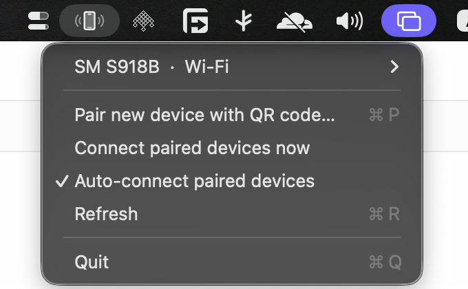
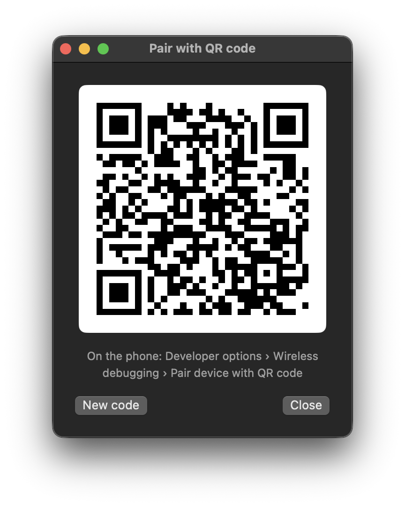

# Wireless ADB

A small macOS menu bar app for connecting Android devices to `adb` over Wi-Fi by scanning a QR code — the same flow Android Studio uses, without opening Android Studio.

<p>
  
  
</p>

## Why

Android 11 added Wireless debugging, but using it from the command line is tedious:

- Pairing means reading an IP, a port and a six-digit code off the phone and typing `adb pair 192.168.1.69:37099 482913`.
- The connect port changes every time Wireless debugging is toggled or the phone reboots, so you look it up again and re-run `adb connect`.
- Android Studio's QR pairing does this for you, but only from inside Android Studio, and it doesn't help when you're using VS Code, a terminal, scrcpy or another IDE.

Wireless ADB sits in the menu bar instead. Scan a QR code once; after that the phone connects on its own whenever Wireless debugging is on, and any tool that talks to `adb` can use it.

## Features

- Pair a device by scanning a QR code (Android 11+ Wireless debugging)
- Lists connected devices with model name and USB / Wi-Fi transport
- Auto-connects previously paired devices when Wireless debugging is turned on
- Disconnect or copy a device serial from the menu

## Requirements

- macOS 14 or later
- Android SDK platform-tools (`adb`). The app looks in `$ANDROID_HOME`, `$ANDROID_SDK_ROOT`, `~/Library/Android/sdk/platform-tools`, `/opt/homebrew/bin` and `/usr/local/bin`.
- Mac and phone on the same Wi-Fi network

## Install

Download `WirelessADB.zip` from [Releases](../../releases), unzip and move `WirelessADB.app` to Applications. Releases are signed with a Developer ID and notarized by Apple. The app is a universal binary (Apple silicon and Intel).

## Build from source

```sh
git clone https://github.com/theGBguy/WirelessADB.git
cd WirelessADB
./build.sh            # builds build/WirelessADB.app (ad-hoc signed)
./build.sh --install  # also copies it to ~/Applications
```

To sign and notarize a local build, see the variables at the top of [`build.sh`](build.sh).

You can also open `Package.swift` in Xcode.

## Usage

1. Click the menu bar icon and choose **Pair new device with QR code…**
2. On the phone: **Settings › Developer options › Wireless debugging › Pair device with QR code**, then scan.
3. The app pairs and connects. After that, the device reconnects automatically whenever Wireless debugging is on.

Allow **Local Network** access when macOS asks — it's needed to find the phone.

## How it works

The QR code encodes `WIFI:T:ADB;S:<name>;P:<password>;;`. After scanning, the phone advertises a `_adb-tls-pairing._tcp` Bonjour service with that name; the app resolves it and runs `adb pair`. It then finds the phone's `_adb-tls-connect._tcp` service and runs `adb connect` (unless adb's own mDNS auto-connect already did).

## License

[MIT](LICENSE)
